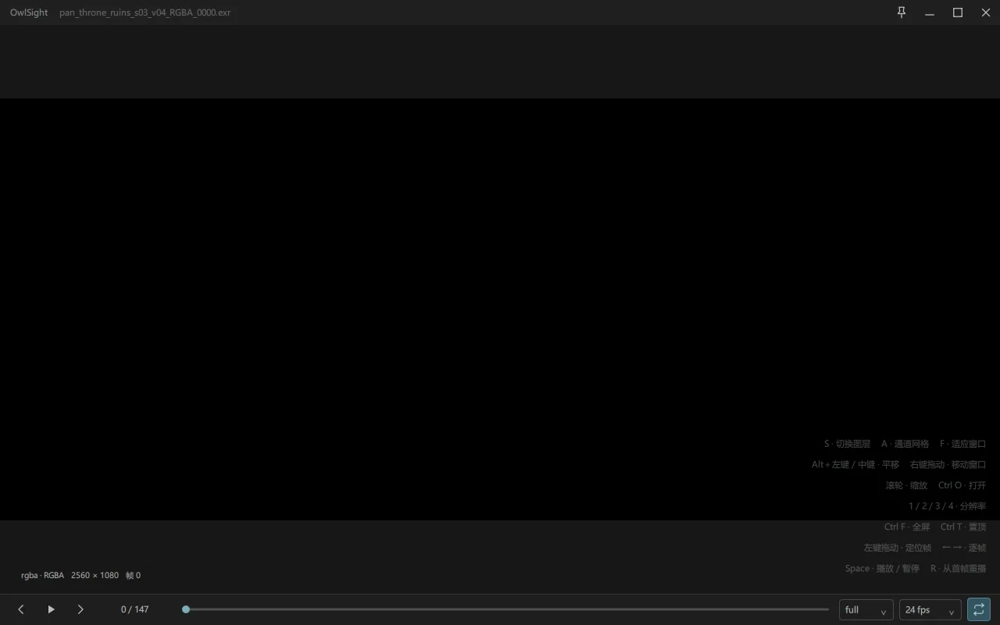

# OwlSight

轻量的 Windows EXR 图像与序列查看器，支持通道查看、序列播放和 OpenColorIO 色彩管理。



[下载 v0.2.1](https://github.com/7Zander/OwlSight/releases/tag/v0.2.1) · [问题反馈](https://github.com/7Zander/OwlSight/issues)

## 功能

- EXR 单帧与序列浏览、循环播放、逐帧和拖动定位。
- 图层与 RGBA 分量切换、静态通道网格、缩放和平移。
- 多档预览分辨率、自动或手动缓存。
- sRGB、Raw、范围映射、曝光及 OCIO 显示变换。

## 使用

下载 Windows x64 程序包，完整解压后运行 `OwlSight.exe`，无需安装。请保留同目录的 DLL、qml 和 plugins 文件夹。

打开 EXR 或将文件拖入窗口；右键菜单提供通道、色彩和缓存设置。

| 按键 | 操作 |
| --- | --- |
| Space | 播放 / 暂停 |
| ← / → | 逐帧浏览 |
| S | 切换图层 |
| A | 单图 / 静态通道网格 |
| 1 / 2 / 3 / 4 | 完整、1/2、1/3、1/4 分辨率 |

设置保存在程序旁的 `settings/`；日志仅在手动开启记录后写入 `logs/`。当前不支持 Deep EXR 和子采样通道。

## 构建

需要 Windows x64、PowerShell、Node.js、Git，以及支持 7z 的 `tar.exe`。在仓库根目录执行：

```powershell
powershell -ExecutionPolicy Bypass -File app/scripts/build-native.ps1 -PrepareQt
powershell -ExecutionPolicy Bypass -File app/scripts/package-native.ps1
```

脚本准备固定版本依赖并核对归档摘要。构建产物位于 `build/`，程序包位于 `dist/v0.2.1/build-0038/`。

## 许可

[GPL-3.0-or-later](LICENSE)。第三方组件与许可见 [THIRD_PARTY_NOTICES.md](THIRD_PARTY_NOTICES.md)。
